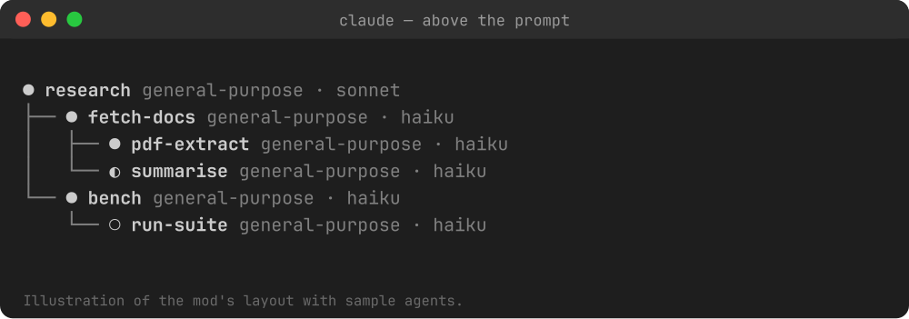

# agent-tree

A [Claude Code](https://claude.com/claude-code) mod that draws running subagents as a tree (like `tree`) above the prompt, so you can see which agent spawned which.



## Under the status line

The same tree also drives the subagent panel of [claude-statusline](https://github.com/Lucasbk38/claude-statusline): one row per agent with model, effort and token count.


## Features

- Shows every live agent, plus finished parents that still have running children.
- Each row: status icon, name, agent type, model family.
- Writes the parent links to `~/.claude/statusline/agent-parents.json` once a second (only when they change) so the companion [claude-statusline](https://github.com/Lucasbk38/claude-statusline) subagent panel can draw the same tree.

## Install

macOS / Linux / Windows (any shell with `claude` on the PATH):

```sh
claude plugin marketplace add Lucasbk38/claude-agent-tree && claude plugin install agent-tree@claude-agent-tree
```

On Windows PowerShell 5, replace `&&` with `;`. Then restart Claude Code, or run `/reload-plugins`.

Tip: nested subagents are limited to 3 levels by default. Raise it with `CLAUDE_CODE_MAX_SUBAGENT_SPAWN_DEPTH` (for example `5`) in the `env` block of `settings.json`.

## Notes

The image is an illustration of the layout with sample agents. MIT licensed.
